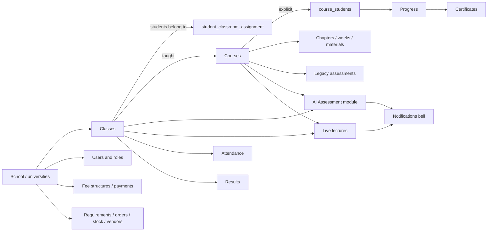

# Product overview

## What the LMS is

This is a multi-school learning management system. It is branded "Core5 Academy" in the user interface.

One installation serves several schools. Each school has its own administrators, teachers, students and finance and procurement staff, and the server keeps every school's data apart (see [03](03_ROLES_PERMISSIONS.md#school-isolation)).

Its main capabilities:

- **School structure.** Classes, plus the teachers and students who belong to them.
- **Courses.**
  - A course is taught to one or more classes and has content: chapters, weeks and materials.
  - Students take a course only when they are explicitly enrolled in it.
- **Assessment.** Two systems exist side by side:
  - a legacy quiz feature (`/api/assessments`);
  - the newer AI Assessment module (`/api/assessment-agent`), which covers tests, assignments with PDF submission, AI question generation and performance reports.
- **Attendance and results.**
  - Attendance: daily present/absent per class.
  - Results: term results per student with configurable subjects.
- **Live lectures.** Embedded video classes through Jitsi as a Service (JaaS), with lecture history and attendance.
- **Communication.** Announcements, targeted notifications (the bell), a calendar, and email.
- **Fees.**
  - Fee structures per grade and student fee schedules.
  - Online payment through Razorpay, which is currently switched off.
  - Offline fee collection by an accountant.
- **Procurement.** Teacher requirements, storekeeper orders and stock requests, vendor quotes and bills, and expenses.
- **Platform administration.** Creating schools and their admins, subscriptions and plans, and demo requests.
- **Bilingual content and UI translation.** English, Arabic and Urdu.

## Roles and portals

| Role (stored value) | Portal (frontend prefix) | Belongs to a school | Purpose |
|---|---|---|---|
| `student` | `/student/*` | Yes | Learns: courses, tests, assignments, attendance, results, lectures, fees |
| `mentor` (also `teacher`) | `/mentor/*`, `/teacher/*` | Yes | Teaches courses, runs classes, marks attendance and results, starts lectures |
| `admin` | `/admin/*` | Yes | Runs one school: classes, courses, users, fees, imports |
| `accountant` | `/accountant/*` | Yes | Fees collection, payments, expenses, vendor invoices |
| `storekeeper` | `/storekeeper/*` | Yes | Orders, stock requests, inventory |
| `vendor` | `/vendor/*` | Linked by `vendors.university_id` | Outside supplier: quotes, bills, orders, stock |
| `superadmin` | `/superadmin/*` | No | Platform owner: schools, school admins, plans |

**Evidence:** `client/src/App.jsx` (83 routes with `requiredRole`), `server/config/accessPolicy.js` (role constants and rules), `client/src/components/ProtectedRoute.jsx` (`mentor` also admits `teacher`).

Being a class teacher and being a course teacher are not separate roles. Both are `mentor` accounts, distinguished by how they are linked to a class or a course (see [03](03_ROLES_PERMISSIONS.md#teachers-class-teacher-vs-course-teacher)).

## Main modules and how they relate

## Verified workflows (summary)

| Workflow | Where described |
|---|---|
| Sign in, sign out, password reset by email code | [04a](04a_WORKFLOWS_ACCOUNTS_AND_ACCESS.md) |
| Admin creates students and teachers; one-time password shown once | [04a](04a_WORKFLOWS_ACCOUNTS_AND_ACCESS.md) |
| Class-first setup: a class (with a required class teacher) before courses and fee structures | [04b](04b_WORKFLOWS_TEACHING_AND_LEARNING.md) |
| Course created for classes, all students or selected students, saved in one transaction | [04b](04b_WORKFLOWS_TEACHING_AND_LEARNING.md) |
| Per-class enrolment management (tick / untick students) | [04b](04b_WORKFLOWS_TEACHING_AND_LEARNING.md) |
| Teacher views "My students" by course or by class | [04b](04b_WORKFLOWS_TEACHING_AND_LEARNING.md) |
| Attendance marking, results entry, certificates on full chapter completion | [04b](04b_WORKFLOWS_TEACHING_AND_LEARNING.md) |
| AI Assessment tests linked to a class and a course | [04b](04b_WORKFLOWS_TEACHING_AND_LEARNING.md) |
| Live lecture start or schedule, embedded join, attendance, history | [04c](04c_WORKFLOWS_LIVE_CLASSES_AND_NOTIFICATIONS.md) |
| Notifications for lectures, assignments, results, calendar events | [04c](04c_WORKFLOWS_LIVE_CLASSES_AND_NOTIFICATIONS.md) |

## Known limitations

- **Online fee payment is off.** Payment endpoints answer HTTP 503 while Razorpay keys are absent. This is deliberate for now; see [09](09_INTEGRATIONS_AND_CONFIGURATION.md#external-services) and [04d](04d_WORKFLOWS_FEES_PROCUREMENT_PLATFORM.md#online-payment-razorpay-currently-off).
- **Self-registration is off by default.** It needs `ALLOW_PUBLIC_REGISTRATION` and `PUBLIC_REGISTRATION_SCHOOL_ID`.
- **Lecture attendance is only partly measured.** Without a JaaS webhook secret it comes from the in-meeting page's heartbeats. Cloud recording is not enabled.
- **The database is SQLite only.** `USE_POSTGRES` has no effect (`server/config/database-switch.js`). The PostgreSQL multi-tenant files are not used by the core (Gap; see [12](12_GAPS_AND_OPEN_QUESTIONS.md)).
- **There is no chatbot or retrieval-augmented generation (RAG) pipeline yet.** The AI features that do exist are question generation, assignment evaluation, performance reports and Excel import mapping. All of them run through the two modules in `ai-modules/`.
