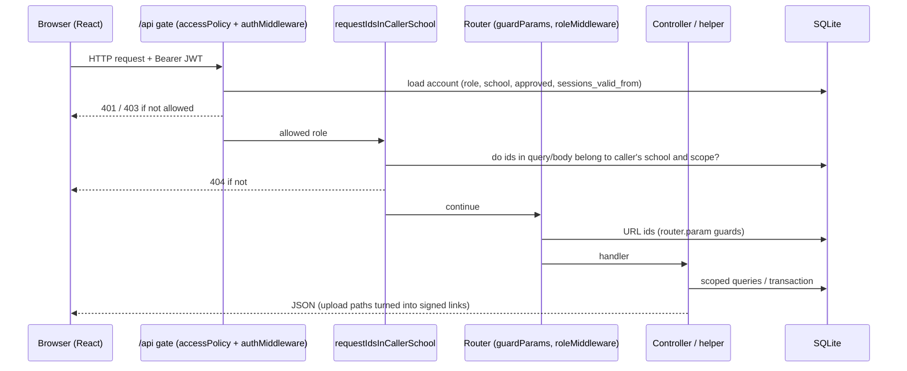
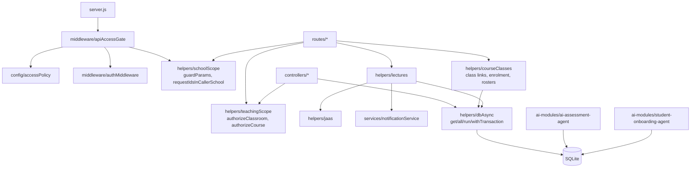

# System architecture

## Components

| Component | Location | Technology | Entry point |
|---|---|---|---|
| Web client | `client/` | React 18 + Vite, React Router, Tailwind CSS, axios / fetch, socket.io-client | `client/src/main.jsx` → `client/src/App.jsx` |
| API server | `server/` | Node.js, Express, socket.io | `server/server.js` |
| Database | `server/data/lms_permanent.db` (path from `LMS_SQLITE_PATH` / `server/config/dbPath.js`) | SQLite (`sqlite3` driver for the core) | `server/config/sqlite-db.js` (schema created and migrated at startup) |
| AI Assessment module | `ai-modules/ai-assessment-agent/` | Node.js, `node:sqlite` / `better-sqlite3`, Hugging Face provider | `backend/src/integration/lmsAssessmentAgent.js`, mounted at `/api/assessment-agent` |
| Student Onboarding module | `ai-modules/student-onboarding-agent/` | Node.js, ExcelJS, LLM column mapping | `backend/src/integration/lmsOnboarding.js`, mounted at `/api/onboarding` and `/api/student-setup` |
| Uploaded files | `server/uploads` (or `LMS_UPLOADS_DIR`) | Served only through signed, expiring links | `server/middleware/uploadPolicy.js` |

- **Verified:** SQLite is the only database the core uses. `server/config/database-switch.js` warns that `USE_POSTGRES=true` has no effect.
- **Gap:** `server/config/master-db.js`, `tenant-connection-manager.js` and `multi-tenant-db-isolated.js` contain a PostgreSQL multi-tenant design. The core does not use it, and parts of the superadmin code still refer to it (see [12](12_GAPS_AND_OPEN_QUESTIONS.md)).

## Request lifecycle (API)

The order below is the order of `app.use(...)` in `server/server.js`.

1. **Async error capture.** `require("./middleware/asyncErrors")` (line 13).
2. **Security headers.** `securityMiddleware` (helmet, Content Security Policy) at line 38.
3. **Access log.** Line 50; switched off with `LMS_ACCESS_LOG=off`.
4. **300 s request timeout.** Line 72.
5. **CORS.** An explicit allow-list (`getAllowedOrigins()`) with credentials.
6. **Body parsing.** JSON (`JSON_BODY_LIMIT`, default 5 MB) and URL-encoded. The raw body is kept only for `/api/live-classes/webhooks/*`, for the webhook signature check.
7. **Realtime helper.** `req.io.emit()` reaches only the caller's own school room (line 179).
8. **Language middleware.**
9. **`/uploads`.** `requireSignedUploadLink`, then static files.
10. **`/api` gate.** `rateLimiters.general` then `apiAccessGate` (line 258). For a non-public path the gate:
    1. finds the first matching rule in `config/accessPolicy.js`;
    2. runs `authMiddleware` (JWT plus a database check of the account);
    3. checks the caller's role against the rule;
    4. requires a school for school roles;
    5. turns stored upload paths in responses into signed links;
    6. runs `requestIdsInCallerSchool`, which checks every known id in the query string and the JSON body (see [03](03_ROLES_PERMISSIONS.md#global-id-guard)).
11. **Routers.** Mounted at lines 263–371. Inside them:
    - `router.param` guards (`guardParams`) check ids in the URL;
    - some routes add `roleMiddleware([...])`;
    - controllers and helpers apply object-level rules.
12. **Fallbacks.** A JSON 404 for unknown `/api` paths, then `globalErrorHandler`.

## Authentication model

- **Tokens.**
  - The token is a JWT signed with HS256 (fixed in `server/config/jwt.js`, `ALGORITHM`) using `JWT_SECRET`. `signToken` defaults to a 7-day lifetime.
  - The browser keeps it in `localStorage` under `token` (`client/src/auth/auth.jsx`, `client/src/utils/axiosInstance.js`) and sends it as `Authorization: Bearer <token>`.
- **The server re-checks the account on every request** (`server/middleware/authMiddleware.js`, `resolvePrincipal`). Role and school are taken from the database row, never from the token. A request is refused when:
  - the account no longer exists;
  - the account is not approved (`users.isApproved = 0`);
  - the token was issued before `users.sessions_valid_from` (set by logout and by password reset);
  - the token's school or role no longer matches the account.
- **Superadmin tokens** have their own branch: a `superadminId` claim, checked against a `superadmins` table. Gap: that table does not exist in the local SQLite database; see [12](12_GAPS_AND_OPEN_QUESTIONS.md).
- **Vendor tokens** are checked against the `vendors` table.
- **Socket.io connections** authenticate with the same token. Each socket joins `user:<id>` and `school:<id>` rooms (`server/server.js` lines 139–160). Realtime events are therefore delivered only within one school, or to one user.

## Background jobs

They are started by `server/server.js` and switched off together with `LMS_DISABLE_BACKGROUND_JOBS`:

| Job | File | What it does |
|---|---|---|
| Notification sweep | `server/schedulers/notification-scheduler.js` | Periodic (`NOTIFICATION_SWEEP_INTERVAL_MS`). Creates `ASSIGNMENT_DUE_SOON` and `ATTENDANCE_PENDING` notifications (after `ATTENDANCE_REMINDER_HOUR`). Deduplicated per recipient. |
| Subscription scheduler | `server/schedulers/subscription-scheduler.js` | Subscription expiry handling (Documented; not traced) |
| Plan monitor | `server/schedulers/plan-monitor.js` | Plan status caching and checks (Documented; not traced) |

Live lectures deliberately have no scheduler. A scheduled lecture is started by hand (see [04c](04c_WORKFLOWS_LIVE_CLASSES_AND_NOTIFICATIONS.md)).

## Module dependencies (server)

- `helpers/dbAsync.js` wraps the single shared SQLite connection. `withTransaction` queues transactions so that two never overlap.
- The two AI modules open the same database file through their own adapters, for example `SqliteAssessmentLmsAdapter`. They re-check the caller's role and school themselves; the gate only lets `LEARNING` roles through (`accessPolicy.js` line 82).

## Frontend structure

- **Routes.** `client/src/App.jsx` declares 83 routes. `ProtectedRoute` (`client/src/components/ProtectedRoute.jsx`) redirects users who are not signed in, or whose role does not match `requiredRole`.
  - This is **only a usability measure**. The server performs the real checks.
- **Layouts.** Each role has a layout with a sidebar: `AdminLayout`, `MentorLayout`, `StudentLayout`, and the accountant, storekeeper and vendor dashboards.
- **API base.** `client/src/config/api.js` (`API_BASE`). Pages call `fetch(`${API}/...`)` or axios with the Bearer token.
- **Realtime.** The client opens a socket.io connection with the session token (`auth.jsx`). It receives `notification:new` and school-scoped events.

## Tests that document behaviour

| Suite | Location | Count on 16 Oct 2026 |
|---|---|---|
| Server security and integrity | `server/tests/security/*`, `server/tests/integrity/*` | 368 passed |
| AI Assessment module | `ai-modules/ai-assessment-agent/tests` | 532 passed (last run before the live-class work; not re-run on 16 Oct) |
| Student Onboarding module | `ai-modules/student-onboarding-agent` | 343 passed (same caveat) |
| Browser end-to-end (four portals, visible Chrome) | `server/tests/e2e/portals.e2e.js` with `stack.js` | 42 checks passed |

Tests run against temporary databases. They refuse to start if real service secrets are present in the environment (`server/tests/helpers/testApp.js`, `REAL_SERVICE_VARIABLES`).
