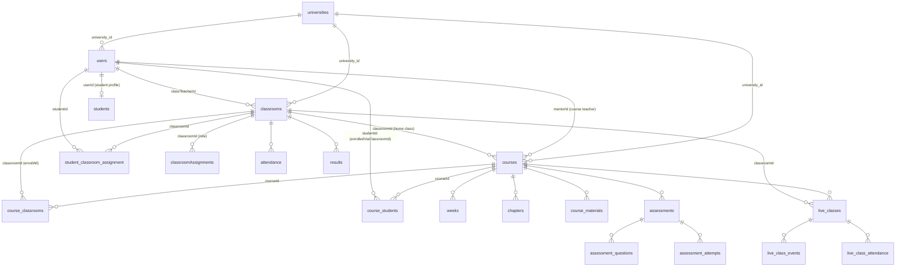

# Data model

## Basics

- **Engine:** SQLite, one file (`server/data/lms_permanent.db` by default).
- **Where the schema comes from:**
  - **LMS tables** are created and migrated at server start by `server/config/sqlite-db.js`, using `CREATE TABLE IF NOT EXISTS`, additive `ALTER TABLE ... ADD COLUMN`, and one-time migrations gated by `PRAGMA user_version`.
  - **AI Assessment tables** (`aia_*`) come from SQL migrations in `ai-modules/ai-assessment-agent/backend/migrations/` (001–010), applied with that module's `scripts/applyMigration.js`.
- **Contents:** on 16 October 2026 the local database had 60 tables. Names, columns and declared foreign keys were read with `PRAGMA` only; no rows were read.
- **Foreign keys** are declared on many tables. SQLite **enforces them only when `LMS_ENFORCE_FOREIGN_KEYS=true`** (`sqlite-db.js`, line 20). That setting is off by default, so treat foreign keys as documentation of intent unless it is on.

## School (tenant) ownership

Every record belongs to one school (`universities.id`):

- **directly**, through `university_id`: users, classrooms, courses, announcements, calendar_events, feeStructures, expenses, inventory, orders, vendors, request_templates, stock_requests, live_classes, aia_*;
- **or through a parent record:**
  - a week, chapter, material, assessment or live class belongs to its course;
  - a result or attendance row belongs to its classroom;
  - a certificate or progress row belongs to its student.

`server/helpers/schoolScope.js` (`SCHOOL_QUERY`) is the single place that encodes these links.

## Core entities and relationships

### Identity and school

| Table | Important columns | Meaning |
|---|---|---|
| `universities` | `id`, `name`, `adminId`, `subscriptionPlan` | A school (tenant) |
| `users` | `id`, `name`, `email`, `password` (bcrypt hash), `role`, `university_id`, `isApproved`, `sessions_valid_from`, `classroom_id` (legacy) | Every person who signs in, except vendors. `role` is `student`, `mentor`, `teacher` (legacy alias), `admin`, `accountant`, `storekeeper` or `superadmin`. |
| `students` | `userId`, `studentId`, `grade`, `rollNumber`, `totalFees`, `feesPaid`, `pendingFees` | Student profile and fee totals |
| `vendors` | `id`, `name`, `email`, `university_id`, … | Suppliers; they sign in through the vendor branch of login |
| `user_language_preferences` | `user_id`, `language_code` | UI language |

### Classes, courses, enrolment

| Table | Important columns | Meaning |
|---|---|---|
| `classrooms` | `university_id`, `name`, `grade`, `section`, `classTeacherId`, `classTeacher` (legacy), `timetable` | A class, for example 5-A. `classTeacherId` is the class teacher. |
| `classroomAssignments` | `classroomId`, `teacherId`, `role` | Extra teacher links to a class. Only `role = 'class_teacher'` makes someone class teacher. |
| `student_classroom_assignment` | `studentId`, `classroomId` | Class **membership** |
| `courses` | `university_id`, `title`, `mentorId`, `classroomId` | A course. `mentorId` is its teacher; `classroomId` is its **home class**. |
| `course_classrooms` | `courseId`, `classroomId`, `enrollAll` (1 = all students and later joiners, 0 = selected only), `assignedBy`; UNIQUE(courseId, classroomId) | The classes a course is taught to (the home class included) |
| `course_students` | `courseId`, `studentId`, `enrolledViaClassroomId` (NULL = enrolled individually); UNIQUE(courseId, studentId) | **Enrolment**: the only thing that decides who takes a course |

- **Verified rule:** class membership does not imply enrolment ([03](03_ROLES_PERMISSIONS.md#students-enrolment-decides-course-access)).
- **One-time migration:** "explicit enrolment" (`migrateToExplicitEnrolment`, `PRAGMA user_version = 1`). It enrolled the members of existing home classes once, so nobody lost a course when the rule changed. It made a backup file first.

### Content, assessment, progress

| Table | Meaning |
|---|---|
| `weeks`, `chapters` (`videoUrl`, `fileUrl`, `imageUrl`), `course_materials` (`type`: video, pdf, file, video_link, pdf_link) | Course content |
| `assessments` (`startTime`, `endTime`, `timer`, `isPublished`), `assessment_questions`, `assessment_attempts` (unique index: one per student per quiz) | Legacy quizzes |
| `progress` (`studentId`, `courseId`, `contentType`, `contentId`, `completed`) | Completion marks; certificates need every chapter completed |
| `certificates` (`studentId`, `courseId`, `certificateUrl`) | Issued certificates |
| `aia_assessments` (`classroom_id`, `course_id` (NULL = legacy), `status`, `opens_at`, `closes_at`), `aia_questions`, `aia_options`, `aia_assessment_recipients`, `aia_attempts`, `aia_attempt_answers`, `aia_attempt_responses`, `aia_attempt_archive` | AI Assessment tests and attempts (`archive` keeps attempts that were reset) |
| `aia_assignments`, `aia_assignment_questions`, `aia_assignment_submissions` (PDF `storage_key`, `sha256`, `ai_*` proposal fields) | Descriptive assignments |
| `aia_performance_reports` (`content_json`, `shared_at`, `read_at`) | Teacher-generated student reports |

### School operations

| Table | Meaning |
|---|---|
| `attendance` (`classroomId`, `studentId`, `date`, `status`, `markedBy`); unique (classroomId, studentId, date) | Daily attendance: present or absent |
| `results` (`classroomId`, `studentId`, `term`, `subjects` JSON, `overallPercentage`, `overallStatus`), `classroom_subjects`, `student_subject_overrides`, `student_subject_settings` | Term results and subject configuration |
| `announcements` | Announcements **and** targeted notifications (`recipientUserId`, `type`, `entityType`, `entityId`, unique `dedupeKey`, `readBy`) |
| `calendar_events` (`publishFor`, `courseId`, `classroomId`) | School calendar |
| `live_classes` (+ `classroomId`, `university_id`, `provider`, `providerRoom` (unique), `requestKey`, `status`, `cancelledAt`, `endedBy`, `attendanceState`) | Live lectures; older rows may lack the new columns |
| `live_class_events` (`kind`: join, leave or beat; `source`: provider or client; `at`; unique `dedupKey`) | Raw presence events |
| `live_class_attendance` (`attendedSeconds`, `intervals`, `status`: pending, attended, missed or unknown); UNIQUE(liveClassId, studentId) | Per-student lecture attendance, recomputed from events |
| `live_class_attendees` | Older attendance table, **no longer written** |

### Fees, payments, subscriptions

| Table | Meaning |
|---|---|
| `feeStructures` (`category`, `grade`, component fees, `totalFee`, `installmentOptions`) | Fee structure per school and category |
| `student_fee_schedules` (`scheduleSnapshot`, `totalFeePaise`, `status`) | A student's installment plan |
| `payments` (`razorpay_*`, `scheduleId`, `installmentStage`, `allocationStatus`, `idempotenc…`), `payment_orders` | Payments and gateway orders |
| `subscriptions` (`superadminId`, `planType`, `status`, `expiryDate`, `isFreeTrial`) | Platform plans |
| `expenses`, `inventory` | Finance and store records |

### Procurement

`requirements`, `requirement_items`, `orders`, `stock_requests`, `stock_request_items`, `request_templates`, `request_notifications`, `vendor_quotes`, `vendor_quote_items`.

### Platform and other

| Table | Meaning |
|---|---|
| `demo_requests` | Marketing "Book a demo" requests |
| `translations` | Bilingual content (English, Arabic, Urdu) |
| `otp_reset` | Password-reset codes. **Created when first needed** by `services/otpService.js`; not present in a database that has never handled a reset. |

**Gap:** a `superadmins` table is read by `authMiddleware` and `routes/superadminRoutes.js` but does not exist in the local database.

## Deletion behaviour

| Action | What is deleted | What stays |
|---|---|---|
| Delete user (`adminController.deleteUser`) | `students` row, `users` row | Enrolments, attendance, results, submissions and progress stay as orphans when foreign keys are not enforced (Inferred) |
| Delete course (`course-controller.deleteCourse`) | `course_classrooms` rows, `courses` row | Enrolments and content rows are not explicitly deleted (Inferred from the handler) |
| Remove a class from a course | `course_classrooms` row, enrolments with that `enrolledViaClassroomId` | Individual enrolments; everything else |
| Untick a student for a course (per class) | That `course_students` row | Account, class membership, marks, submissions |
| Cancel a lecture | Nothing; status becomes `cancelled` | All history |
| Delete a class (`DELETE /api/classrooms/:id`) | **Nothing**: the handler is a stub that answers success | Everything (Gap) |
| Reset an AI test attempt | The attempt is moved to `aia_attempt_archive` | History |

## Sensitive data categories

| Category | Where | Notes |
|---|---|---|
| Credentials | `users.password` (bcrypt), `otp_reset.otp` (stored hashed), `vendors.password` | Never returned by APIs (`universalRoutes` hides `password`) |
| Personal data of minors | `users` (name, email), `students` (roll number), attendance, results, submissions, performance reports | Needs a strict need-to-know: students see only their own records; email addresses are hidden from classmates |
| Financial | `payments`, `student_fee_schedules`, `students` fee totals | Finance roles and the student themself |
| Uploaded files | `server/uploads`, assignment PDFs (`AIA_SUBMISSIONS_DIR`), question images | Served only through signed, expiring links or authenticated module routes |
| Secrets | Not in the database. They are environment variables ([09](09_INTEGRATIONS_AND_CONFIGURATION.md)). | |
